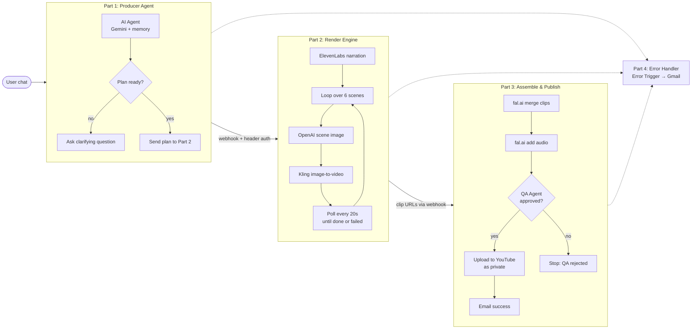
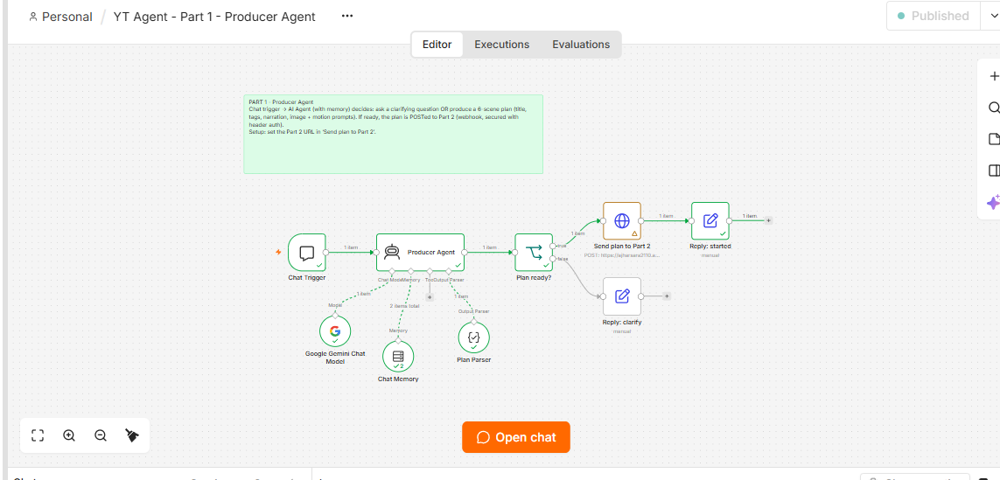
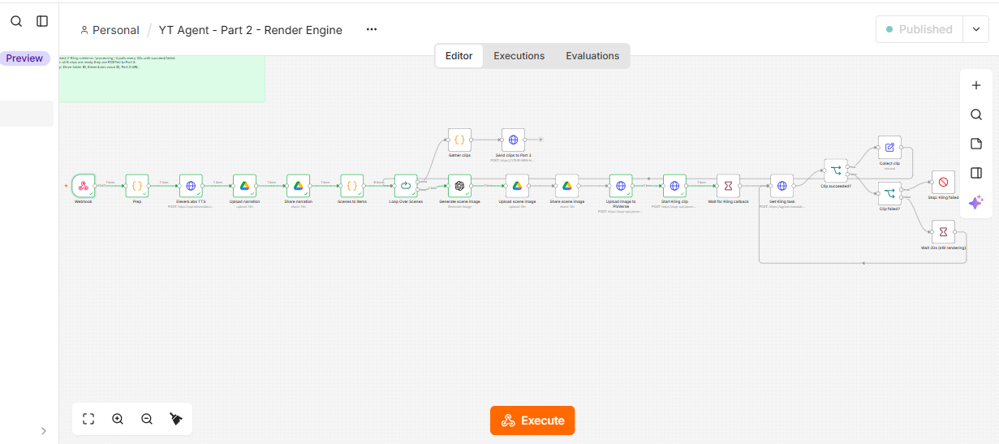
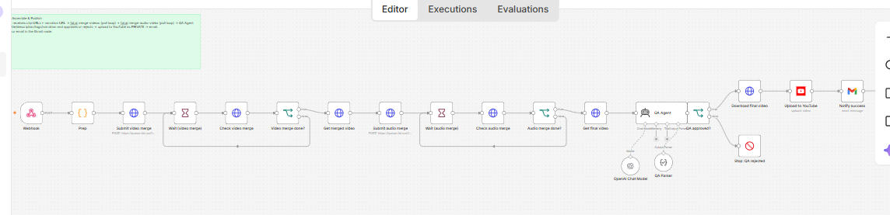
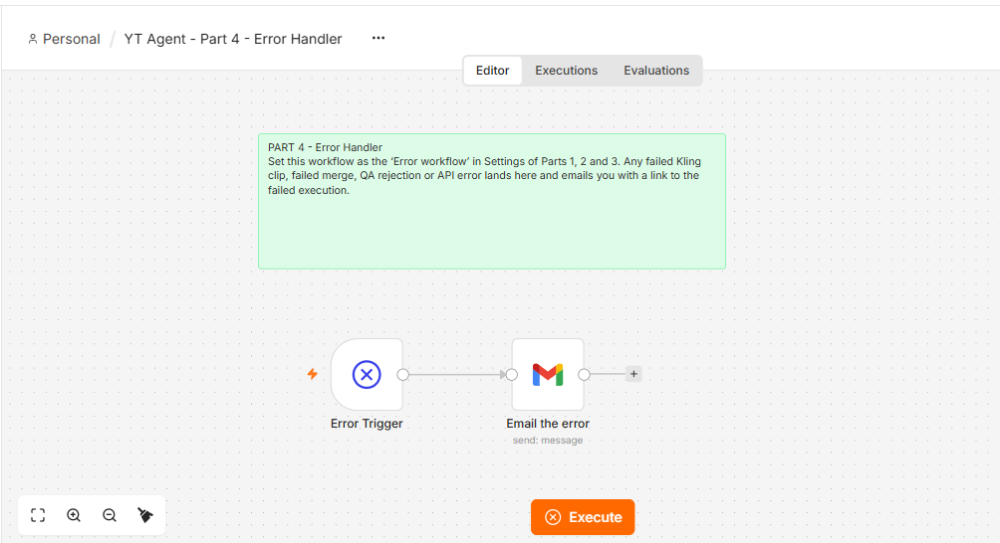

# YouTube Automation Agent

**Chat a video idea. Get a QA-checked, narrated, AI-generated video uploaded to YouTube.**

An end-to-end, multi-workflow automation built in **n8n**. A conversational AI agent turns a rough idea into a 6-scene production plan, then a render pipeline generates narration, images and video clips, merges everything, runs an AI quality check, and publishes to YouTube as a private draft. Failures are caught and emailed with a link to the broken execution.


---

## What it does

1. You describe a video idea in a chat window.
2. The **Producer Agent** either asks a clarifying question or returns a structured plan: title, tags, narration, and an image + motion prompt for each of 6 scenes (~30 seconds total).
3. The **Render Engine** records narration, generates a still image per scene, animates each into a clip with Kling, and polls until every clip is done.
4. The **Assemble & Publish** stage merges clips and audio, lets a **QA Agent** approve or reject the result, then uploads approved videos to YouTube as **private** and emails you.
5. The **Error Handler** emails you if anything fails in the three stages above.

> [Demo video / sample output: add link here]

---

## Architecture

The system is four separate n8n workflows connected by authenticated webhooks. Splitting it this way keeps each workflow small, lets long-running steps (video rendering) run independently, and means one failure doesn't take down the chat experience.



### Stage by stage

| Stage | Workflow | What happens |
|---|---|---|
| 1 | **Producer Agent** | Chat trigger feeds an AI Agent with conversation memory. A structured output parser forces the plan into a strict schema (title, tags, narration, image and motion prompts). An IF node decides: plan complete → POST to Part 2, otherwise reply with a clarifying question. |
| 2 | **Render Engine** | Generates narration with ElevenLabs and stores it in Google Drive. Loops over each scene: generate image (OpenAI), store in Drive, start the Kling clip, wait for the callback, then poll the task status every 20s. Succeeded clips are collected; a failed clip stops the run. All clip URLs are sent to Part 3. |
| 3 | **Assemble & Publish** | Submits a video merge job, polls until done, submits an audio merge job, polls again. The final video goes to a QA Agent with a structured parser. Approved: download, upload to YouTube as private, email notification. Rejected: stop and alert. |
| 4 | **Error Handler** | Set as the *Error workflow* for Parts 1-3. Any failed clip, failed merge, QA rejection or API error triggers an email with a link to the failed execution. |

---

## Workflow screenshots

### Part 1: Producer Agent


### Part 2: Render Engine


### Part 3: Assemble & Publish


### Part 4: Error Handler


---

## Design decisions

- **Four workflows, not one.** Each stage can be tested, replayed and debugged on its own. A render failure doesn't force you to redo planning.
- **Webhook handoffs with header auth.** Parts 2 and 3 are not publicly callable without a secret.
- **Structured output at both AI steps.** The planner and the QA agent return parsed JSON, not free text, so downstream nodes never guess at the format.
- **Clarify before spending money.** The agent asks questions when the idea is vague, so expensive image and video calls only run on a complete plan.
- **Poll with a loop and a failure exit.** Kling jobs are asynchronous. The workflow waits, checks status every 20s, and stops cleanly on failure instead of hanging.
- **QA gate before publishing.** An AI review sits between rendering and upload, and uploads are private by default so a human gives the final go-ahead.
- **Centralized error handling.** One error workflow for everything, with a direct link to the failing execution.

---

## Tech stack

| Area | Tools |
|---|---|
| Orchestration | n8n (4 workflows, webhooks, error workflow) |
| Planning agent | Google Gemini, n8n AI Agent, window buffer memory, structured output parser |
| Narration | ElevenLabs TTS |
| Images | OpenAI image generation |
| Video | Kling (image-to-video) |
| Merge | fal.ai (video merge, audio merge) |
| QA | OpenAI chat model with structured output parser |
| Storage | Google Drive |
| Publish and alerts | YouTube Data API, Gmail |

---

## Setup

### Prerequisites
- n8n instance (cloud or self-hosted) with a public URL for webhooks
- API keys: Gemini, OpenAI, ElevenLabs, Kling provider, fal.ai
- Google OAuth credentials: Drive, Gmail, YouTube

### Steps
1. Import the workflows from `workflows/` in order: Part 4, Part 3, Part 2, Part 1.
2. Create credentials in n8n for each service above.
3. Create a Header Auth credential and attach it to each webhook and to the HTTP nodes that call them.
4. Set the webhook URLs:
   - Part 1, node **Send plan to Part 2** → Part 2 webhook URL
   - Part 2, node **Send clips to Part 3** → Part 3 webhook URL
5. Set the Drive folder ID, ElevenLabs voice ID and Kling endpoint in the relevant nodes of Part 2.
6. Open **Settings → Error workflow** in Parts 1, 2 and 3 and select the Part 4 workflow.
7. Publish all four workflows, open the Part 1 chat, and send an idea.

---

## Repository structure

```text
.
├── README.md                        # Project documentation and architecture guide
├── workflows/                       # Exported n8n workflow JSON pipelines
│   ├── part1-producer-agent.json    # Part 1: Conversational planning agent
│   ├── part2-render-engine.json     # Part 2: Narration, image & video clip generator
│   ├── part3-assemble-publish.json  # Part 3: Clip stitching, QA review & YouTube upload
│   └── part4-error-handler.json     # Part 4: Centralized failure handler & email alert
└── docs/
    └── images/                      # Workflow screenshots and visual assets
        ├── part1-producer-agent.png
        ├── part2-render-engine.png
        ├── part3-assemble-publish.png
        └── part4-error-handler.png
```

> Credentials are never stored in the exported JSON. Remove any hardcoded keys or webhook secrets before committing.

---

## Limitations and next steps

- Videos are fixed at 6 scenes (~30s). Making scene count configurable is the obvious next change.
- Uploads are private only. A human approval step (e.g. Slack or email button) could trigger the public release.
- QA is a single model pass. Adding scene-level checks (image/prompt match, audio sync) would catch more issues earlier.
- Per-video API cost is not tracked yet: [add cost per video once measured].

---

## Background

This project started from a workflow demonstrated in a live automation course. I rebuilt and extended it with a conversational planning agent, ElevenLabs narration, a per-scene render loop with polling and failure handling, an AI QA gate, and a dedicated error-handling workflow.

---

## Author

**Ajhar**
Agentic AI Engineer | AI Automation (n8n, RAG, MCP) | Java/Spring Boot + Python/FastAPI
[LinkedIn: add link] · [GitHub: add link]
